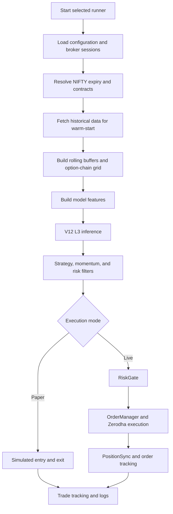

# NIFTY Quant Algo Engine

An ML-assisted algorithmic trading system for **NIFTY 50 options** on Indian market sessions. The project combines live market data, option-chain processing, a trained V12 L3 inference bundle, strategy and risk filters, paper-trade simulation, and broker-integrated live execution.

The repository provides two execution modes:

| Mode | Runner | What it does |
|---|---|---|
| Paper trading | `paper_trading.py` | Consumes live market data and simulates entries, exits, and trade outcomes. It does not submit real broker orders. |
| Live trading | `live_trading.py` | Runs the live strategy and can route eligible orders through the configured Zerodha execution components. |

> [!WARNING]
> **Live trading involves real financial risk.** `live_trading.py` can place real orders in your Zerodha account. The software does not guarantee profits and is not investment advice. Run paper mode first, inspect the logs, understand every risk setting, and independently verify your broker configuration before enabling live execution.

---

## Contents

- [1. Project overview](#1-project-overview)
- [2. How the system works](#2-how-the-system-works)
- [3. Market-session requirements](#3-market-session-requirements)
- [4. Requirements and dependencies](#4-requirements-and-dependencies)
- [5. Installation on Windows](#5-installation-on-windows)
- [6. Download the ML model](#6-download-the-ml-model)
- [7. Configure broker credentials](#7-configure-broker-credentials)
- [8. Generate daily access tokens](#8-generate-daily-access-tokens)
- [9. Run the project](#9-run-the-project)
- [10. Logs and generated files](#10-logs-and-generated-files)
- [11. Project structure](#11-project-structure)
- [12. Machine-learning model](#12-machine-learning-model)
- [13. Troubleshooting](#13-troubleshooting)
- [14. Security and responsible use](#14-security-and-responsible-use)
- [15. License](#15-license)
- [16. Official documentation](#16-official-documentation)

---

## 1. Project overview

NIFTY Quant Algo Engine analyses NIFTY market conditions during live Indian trading sessions and generates option-trading decisions using a trained machine-learning model and additional strategy filters.

At a high level, the application:

1. Connects to the configured market-data services.
2. Resolves the active NIFTY expiry and relevant option contracts.
3. Retrieves historical market data to warm-start the model and strategy state.
4. Maintains rolling buffers for spot, option premiums, volume, open interest, implied volatility, and related market context.
5. Processes option-chain information through `chain_grid.py`.
6. Builds the feature set expected by the V12 L3 model.
7. Evaluates model output alongside momentum, trend, entry, and risk conditions.
8. Simulates a trade in paper mode or routes eligible trades through the live execution components.
9. Tracks orders and positions and writes operational logs.

### Choose an execution mode

**Paper trading is the recommended starting point.** It uses live market data but simulates trades instead of submitting broker orders. It is not a historical backtest and does not guarantee that real orders would receive the same prices or fills.

**Live trading is for users who have independently verified the strategy and broker setup.** It can place real orders. The selected Python runner determines the mode; starting the project from a terminal does not make it paper-only.

## 2. How the system works



The code is split into market-data, feature-engineering, inference, risk, order, and position-management components. See [Project structure](#11-project-structure) for a guide to the main files.

## 3. Market-session requirements

This project is designed for **live NIFTY options-market sessions in India**. The normal NSE equity-derivatives session is **09:15–15:40 IST**, Monday through Friday, excluding exchange-declared holidays. Special sessions or exchange circulars can change the normal schedule. Always check the [NSE market timings and holiday information](https://www.nseindia.com/static/market-data/market-timings) before a session.

The bot also has its own entry and end-of-day controls. Those application-level cutoffs may stop new entries or manage positions before the exchange's formal market close.

Before each trading session, confirm that:

- It is an NSE trading day and the market is open.
- Your Dhan access token is valid.
- Your Zerodha Kite access token has been generated for the current session.
- The model folder and all model artifacts are present.
- Your broker accounts have the required API access, segment permissions, and funds.
- The market-data feed is connected and receiving current ticks.

## 4. Requirements and dependencies

### Supported Python environment

The project environment uses **Python 3.11.8**. Use Python 3.11.8 when recreating the virtual environment so the setup matches the environment used by the maintainer.

You will also need:

- Windows 10 or Windows 11 for the commands in this guide.
- Git, to clone the repository.
- A Zerodha account and Kite Connect API credentials.
- A Dhan account and the required DhanHQ API access.
- The separately distributed `nifty_v12_l3_models` model bundle.
- A stable internet connection during market hours.

### Third-party Python packages

Install the following packages using `pip`. They are the third-party dependencies supplied for this project:

| Package | Main purpose |
|---|---|
| `catboost` | CatBoost model artifact support |
| `dhanhq` | DhanHQ API and market-data integration |
| `joblib` | Loading serialized model and data artifacts |
| `kiteconnect` | Zerodha Kite Connect integration |
| `lightgbm` | LightGBM model artifact support |
| `numpy` | Numerical and array operations |
| `pandas` | Market-data tables and time-series processing |
| `pyarrow` | Parquet cache support |
| `py_vollib` | Option pricing and implied-volatility calculations |
| `requests` | HTTP requests to broker and market-data APIs |
| `scikit-learn` | Machine-learning utilities and model support |
| `urllib3` | HTTP connection and retry support |
| `websockets` | WebSocket communication |
| `xgboost` | XGBoost model artifact support |

The repository's `requirements.txt` should contain **these installable third-party packages only**. The supplied package list did not include version pins, so the list below does not claim to lock exact package versions. For fully reproducible deployments, pin the tested package versions after validating the environment.

### Python standard-library modules

The following names are also used by the project, but they are included with Python 3.11.8 and **must not be installed with `pip`**:

`__future__`, `asyncio`, `collections`, `datetime`, `inspect`, `json`, `logging`, `os`, `pathlib`, `random`, `re`, `socket`, `sys`, `threading`, `time`, `typing`, `urllib`, and `warnings`.

In particular, `urllib` is part of Python, while `urllib3` is a separate third-party dependency. Do not add standard-library module names to `requirements.txt`; doing so can cause package-installation failures.

## 5. Installation on Windows

These instructions use Windows Command Prompt (CMD) and assume that the project will be stored in `C:\niftytrading`. Substitute your own folder if you use a different location.

### Step 1 — Install Git and Python 3.11.8

Install Git and Python **3.11.8**. During Python installation, enable the option to add Python to PATH if the installer offers it.

Open a new Command Prompt and check the tools:

```bat
git --version
py --version
```

If multiple Python versions are installed, make sure the interpreter used to create `.venv` is Python 3.11.8. The Python launcher may select another installed 3.11 patch release, so verify the version after creating the environment.

### Step 2 — Clone the repository

```bat
cd C:\
git clone https://github.com/Jugalsoni18/nifty-quant-algo-engine.git niftytrading
cd C:\niftytrading
```

If you downloaded the repository as a ZIP instead, extract it and open Command Prompt in the extracted project folder.

### Step 3 — Create the virtual environment

From the project root, run:

```bat
py -3.11 -m venv .venv
```

If this does not create the environment with Python 3.11.8, use the full path to your Python 3.11.8 executable instead:

```bat
"C:\Path\To\Python311\python.exe" -m venv .venv
```

Replace the example path with the actual location of your Python 3.11.8 installation.

### Step 4 — Activate the environment

For **Command Prompt (CMD)**:

```bat
.venv\Scripts\activate.bat
```

For **PowerShell**:

```powershell
.\.venv\Scripts\Activate.ps1
```

After activation, the terminal prompt should show `(.venv)`.

### Step 5 — Verify Python and install dependencies

Confirm the environment uses Python 3.11.8:

```bat
python --version
```

Expected output:

```text
Python 3.11.8
```

Then install the third-party dependencies:

```bat
python -m pip install --upgrade pip
python -m pip install -r requirements.txt
```

If an installation fails, resolve the package or environment error before starting either trading runner. Do not try to install Python standard-library modules with `pip`.

### Step 6 — Reopen the project later

Whenever you open a new terminal:

```bat
cd C:\niftytrading
.venv\Scripts\activate.bat
```

You must activate the environment again before running the project.

## 6. Download the ML model

The trained model files are distributed separately from the Python source code. Download the complete model archive here:

[Download `nifty_v12_l3_models` from Google Drive](https://drive.google.com/file/d/17KMh3z1NxbTRS9JQH0YE1tFWIcJQK7xw/view?usp=sharing)

After downloading:

1. Extract the archive.
2. Locate the folder named exactly `nifty_v12_l3_models`.
3. Move that folder directly into the project root, next to `live_trading.py` and `paper_trading.py`.
4. Confirm that the folder contains `v12_meta.json` and the other model artifacts.

The expected layout is:

```text
C:\niftytrading\
│   live_trading.py
│   paper_trading.py
│   v12_inference.py
│   requirements.txt
│
└───nifty_v12_l3_models\
    │   v12_meta.json
    │   model_xgb_long_v12.pkl
    │   model_lgb_long_v12.pkl
    │   model_cat_long_v12.cbm
    │   ...other model artifacts...
```

Do not leave the model folder nested inside another folder with the same name. The incorrect layout would look like:

```text
nifty_v12_l3_models\nifty_v12_l3_models\v12_meta.json
```

### Check the model path

Both runners load the model using their `MODEL_DIR` setting. Open `live_trading.py` and `paper_trading.py`, find `MODEL_DIR`, and make sure it points to the model folder.

For the project layout above, use this project-relative path:

```python
MODEL_DIR = Path(__file__).resolve().parent / "nifty_v12_l3_models"
```

Use the same model folder for both runners. Do not rename, remove, or mix individual files from different model versions; the artifacts are loaded together by `v12_inference.py`.

## 7. Configure broker credentials

The project uses two broker integrations:

- **Dhan:** client ID and access token are used by the market-data and historical-data integration.
- **Zerodha Kite Connect:** API key/secret and a generated session token are used by the Zerodha integration. The live execution components can place and manage orders through this connection.

### Step 1 — Configure `config.py`

The repository includes `config.py` with **placeholder values only**. After cloning, replace the placeholders in your local copy with your own credentials. Keep the existing variable names and data structures unchanged. Never put real credentials in the public GitHub copy.

The supplied configuration contains these credential-related fields:

| Field | Purpose |
|---|---|
| `request_token` | Temporary Zerodha login value used during the request-token exchange, if required by the login flow. It is not the final daily access token. |
| `api_key` | Zerodha Kite Connect API key. |
| `api_secret` | Zerodha Kite Connect API secret. |
| `ZERODHA_USER_ID` | Zerodha login user ID. |
| `ZERODHA_PASSWORD` | Zerodha account password. |
| `ZERODHA_TOTP_SECRET` | Secret used to generate the account's time-based one-time passwords. Treat it as highly sensitive. |
| `dhan_api_key` and `dhan_api_secret` | Dhan API credentials, if required by the configured integration. |
| `DHAN_CLIENT_ID` | Dhan client ID. |
| `DHAN_ACCESS_TOKEN` | Current Dhan access token. |

The file also contains local paths and strategy/risk parameters such as `LOT_SIZE`, `WARMUP_BARS`, VIX filters, `PAPER_TRADE`, and `ZERODHA_CONFIG`. These are operational settings, not credentials. Do not change their names or types without checking the code that consumes them.

### Step 2 — Make local paths portable

Do not publish developer-specific absolute paths such as `C:/NIFTY50/trading` or `C:/niftytrading/...`. They will not match another user's installation directory. The original configuration snippet shared for this README used `os.path.join(BASE_DIR, "C:/niftytrading/nifty_v12_l3_models")`; the second argument is itself an absolute path, so it does not create a model path beneath `BASE_DIR`. The public `config.py` template included in this bundle corrects that path by resolving it relative to the file.

Use paths relative to the location of `config.py` instead:

```python
import os
from datetime import time

BASE_DIR = os.path.dirname(os.path.abspath(__file__))
MODEL_DIR = os.path.join(BASE_DIR, "nifty_v12_l3_models")
ACCESS_TOKEN_FILE = os.path.join(BASE_DIR, "token.json")
TOKEN_FILE = ACCESS_TOKEN_FILE
LOG_FILE = os.path.join(BASE_DIR, "bot_log.csv")
```

Keep the rest of the configuration below this path block. Confirm that the runner and helper modules use the same path variables and that both runners load the model directory from the intended location.

### Step 3 — Verify strategy and execution settings

The supplied configuration sets both `LOT_SIZE` and `ZERODHA_CONFIG["lot_size"]` to `65`. Keep these values consistent and verify the applicable lot size against the current NSE contract master for the exact contract being traded. Exchange lot sizes can change. The original configuration snippet's comment saying that NIFTY's lot size is `25` was outdated and has been removed from the public `config.py` template. NSE revised the NIFTY 50 lot to 65 for the applicable contracts from January 2026.

Also review these settings before using the project:

- `SL_PCT` is shown as the string `"20 points"`, while its comment describes a percentage stop loss. Confirm the expected type and units in the code before changing or relying on it.
- The original configuration snippet had `PAPER_TRADE = True` but `ZERODHA_CONFIG["dry_run"] = False`. Do **not** assume that `PAPER_TRADE` overrides `dry_run`; they may be read by different components. The public `config.py` template in this bundle changes `dry_run` to `True` as a safer starting default. Verify the execution logic in the selected runner and order manager before changing it locally to permit real orders.
- Review `max_lots`, `max_trades_per_day`, `daily_loss_limit`, `max_capital_per_trade`, `product`, and stop-loss settings before live use.

The committed `config.py` is a starter template, not a working credential file. Never publish a populated version, share credentials in screenshots or issues, or use credentials belonging to another person.

## 8. Generate daily access tokens

Both broker sessions must be valid before starting a runner. The repository includes `token.json` with placeholder content only. After cloning, replace the placeholders in your local copy with your current Zerodha session details. The Dhan access token is entered in `config.py`.

The public placeholder `token.json` uses this exact structure:

```json
{
  "api_key": "ZERODHA_API_KEY",
  "access_token": "ZERODHA_ACCESS_TOKEN"
}
```

Keep both JSON keys exactly as shown. The `api_key` value must match your Zerodha API key in `config.py`; `access_token` must contain the final generated Kite access token. Do not put your Zerodha API secret, password, TOTP secret, or a temporary request token in this JSON file.

### A. Zerodha — generate the Kite access token

From the activated virtual environment and project root, run:

```bat
python login.py
```

Follow the instructions printed by the script:

1. Open the Kite login URL displayed in the terminal.
2. Sign in to your own Zerodha account and complete the requested verification.
3. Complete the token-generation flow described by `login.py`.
4. Copy the **final Kite access token** into the `access_token` value in `token.json`.
5. Confirm the `api_key` value in `token.json` matches `api_key` in `config.py`.
6. Save `token.json` in the project root.

Do not paste a temporary `request_token` into the `access_token` field. Preserve the JSON keys and structure shown above.

Kite Connect uses a short-lived request token which is exchanged for an access token. Zerodha documents that the access token expires at **06:00 IST on the following day**, unless invalidated earlier. Generate a fresh session token as required for each trading day.

### B. Dhan — generate a fresh access token

Generate a new Dhan access token before the session:

1. Sign in to [Dhan Web](https://web.dhan.co/).
2. Open **My Profile**.
3. Go to **Access DhanHQ APIs**.
4. Generate a new access token.
5. Copy it into the existing `DHAN_ACCESS_TOKEN` value in `config.py`.
6. Save `config.py`.

Dhan documents the manually generated individual access token as valid for **24 hours from generation**. An expired or replaced token causes authenticated API requests to fail.

> **Daily pre-market checklist:** Run `python login.py`, update `token.json` with the final Zerodha access token, generate a fresh Dhan access token, update `config.py`, and then start the selected runner.

## 9. Run the project

Before starting, confirm that:

- Command Prompt is open in `C:\niftytrading` (or your actual project directory).
- The `.venv` environment is activated and reports Python 3.11.8.
- Dependencies have installed successfully.
- `config.py` contains your own current Dhan and Zerodha configuration.
- `token.json` contains the current Zerodha access token in the expected JSON format.
- The complete `nifty_v12_l3_models` directory is in the project root.
- The NIFTY market is open and the broker/data services are available.

### Option A — Paper trading (recommended first)

```bat
python paper_trading.py
```

Paper mode uses live market data but simulates the trading lifecycle. Use it to observe feed connection, instrument resolution, historical warm-start, model inference, entry filters, simulated trades, and exit conditions without submitting real broker orders.

Paper trading is not a historical backtest and does not validate real order fills. It still requires valid market-data credentials and a working feed.

### Option B — Live trading

```bat
python live_trading.py
```

This runner initializes the live risk, order-management, and position-synchronization components. With live execution enabled in your configuration, it can place real orders in your Zerodha account.

**Do not start live trading until** you have run paper mode, reviewed multiple sessions of logs, confirmed the selected instruments and strikes, checked stop/exit behaviour, and independently verified every live-order setting. Keep the process and broker order book under active supervision.

### Stop the application safely

Use `Ctrl+C` in the terminal running the bot. Then check your broker's actual open orders and positions. Closing the terminal does not guarantee that an open broker position has been closed or that a pending order has been cancelled.

## 10. Logs and generated files

Runtime logs are written to the project's `logs` directory. For the example installation:

```text
C:\niftytrading\logs\
```

Check the log for:

- Broker authentication and WebSocket/feed connection messages.
- NIFTY expiry and instrument resolution.
- Historical warm-start status and missing-data warnings.
- Model loading and feature/inference diagnostics.
- Entry filters and reasons a trade was blocked.
- Paper-trade events or live order events.
- Exit decisions, position reconciliation, and exceptions.

The project may also create or update local instrument caches, including `dhan_scrip_cache.parquet`, `dhan_scrip_cache.meta.json`, and `instruments_cache.json`. These are generated cache files; they are not broker credentials or model artifacts.

## 11. Project structure

The following table describes the main files in the project. `config.py` and `token.json` are committed only as placeholder templates; their populated local versions must never be pushed back to GitHub:

| File or folder | Purpose |
|---|---|
| `live_trading.py` | Live runner. Loads the model and strategy, then uses the configured live risk, order, and position-management components. |
| `paper_trading.py` | Paper runner. Uses live market data and the strategy pipeline while simulating trades instead of placing broker orders. |
| `config.py` | Public starter configuration with placeholders for Dhan credentials, Zerodha API/login values, local paths, and strategy/execution settings. Replace credentials only in your local copy; never publish real credentials. |
| `token.json` | Public placeholder JSON with `api_key` and `access_token` fields for the Zerodha session. Populate it locally through the `login.py` workflow; never publish a real access token. |
| `login.py` | Starts the Zerodha Kite Connect login and token-generation flow. |
| `kite_auth.py` | Creates or returns the authenticated Kite Connect client used by the runners. |
| `v12_inference.py` | Loads the V12 model artifacts, prepares inference inputs, and performs model inference and post-processing. |
| `build_features.py` | Feature-engineering support for constructing the model's input data. |
| `buffer_warmstart.py` | Defines rolling-buffer sizing and helpers used to populate historical data before live processing. |
| `live_warmstart.py` | Fetches and prepares historical market data used to warm-start model and strategy state. |
| `chain_grid.py` | Maintains the option-chain strike grid and supplies per-contract chain data to the feature pipeline. |
| `instrument_mapper.py` | Resolves NIFTY expiries, option contracts, strikes, security IDs, and instrument metadata. |
| `risk_gate.py` | Applies configured risk checks before live order actions. |
| `order_manager.py` | Coordinates live order placement and management. |
| `order_tracker.py` | Tracks order state and execution updates. |
| `position_sync.py` | Reconciles the bot's internal position state with broker positions. |
| `train_l4.py` | Training utility for the L4 model-development path; it is not the normal startup command for the V12 L3 runners. |
| `requirements.txt` | Third-party Python dependencies installed during setup. |
| `nifty_v12_l3_models/` | Separately distributed trained-model artifacts required by `v12_inference.py`. |
| `logs/` | Runtime log files created by the trading runners. |
| `dhan_scrip_cache.parquet` | Local cached Dhan instrument-master data. |
| `dhan_scrip_cache.meta.json` | Metadata associated with the Dhan instrument cache. |
| `instruments_cache.json` | Local instrument and expiry cache. |
| `directory_structure.txt` | Text snapshot of the project directory layout. |
| `.gitignore` | Git exclusions for local environments, logs, and generated cache files. |
| `__pycache__/` | Python-generated bytecode cache; it is recreated automatically. |

## 12. Machine-learning model

The current runners load the **V12 L3** model through `V12Model` in `v12_inference.py`. The inference pipeline expects a **245-feature** input schema assembled from rolling market buffers, option-chain information, and other market context.

The supplied `nifty_v12_l3_models` bundle contains serialized components associated with several estimator families:

| Model family | Example artifacts |
|---|---|
| XGBoost | `model_xgb_long_v12.pkl`, `model_xgb_short_v12.pkl` |
| LightGBM | `model_lgb_long_v12.pkl` |
| CatBoost | `model_cat_long_v12.cbm` |
| ExtraTrees | `model_et_long_v12.pkl`, `model_et_short_v12.pkl` |

The bundle also includes meta-models, feature lists, threshold/margin artifacts, split metadata, and `v12_meta.json`. Treat the directory as one versioned model bundle. Do not delete, rename, or mix files from different model versions.

The artifact names identify the estimator families present; the exact loading, feature selection, meta-model combination, and decision thresholds are defined by `v12_inference.py` and the associated metadata. This README does not infer the model's internal voting or stacking method from the filenames alone.

### The model bundle is required

Installing Python dependencies does not install the trained model. If the model folder is missing, incomplete, nested in the wrong directory, or referenced by an incorrect `MODEL_DIR`, model initialization may fail. Download the complete matching L3 bundle before starting either runner.

## 13. Troubleshooting

| Problem | What to check |
|---|---|
| `ModuleNotFoundError` | Confirm `.venv` is active, check `python --version`, and run `python -m pip install -r requirements.txt`. |
| `pip install -r requirements.txt` tries to install `datetime`, `asyncio`, `logging`, or similar names | Those are Python standard-library modules. Remove them from `requirements.txt`; install only third-party packages. |
| Python version is not 3.11.8 | Recreate `.venv` using the Python 3.11.8 interpreter, then reinstall dependencies. |
| Model file or directory not found | Confirm the folder is named exactly `nifty_v12_l3_models`, is in the project root, and that `MODEL_DIR` in both runners points to it. |
| Zerodha authentication fails | Run `python login.py` again, follow the displayed login URL, and update `token.json` with the final access token. Check the API key and secret in `config.py`. |
| Dhan API returns an authentication error | Generate a fresh Dhan access token and replace `DHAN_ACCESS_TOKEN` in `config.py`. Check the Dhan client ID and API permissions. |
| No market ticks arrive | Confirm the market is open, the date is not an exchange holiday, the Dhan credentials are current, and the feed/network connection is healthy. |
| Instrument or expiry cannot be resolved | Check the Zerodha session, instrument cache, active expiry, Dhan scrip-master download, and internet connection. |
| Parquet engine error while writing the Dhan cache | Confirm `pyarrow` installed successfully inside the active `.venv`; then retry. |
| Warm-start is empty or shorter than expected | Check Dhan historical API authentication, network/API availability, and warm-start messages in the log. Do not bypass warm-up protections just to force entries. |
| Live order is rejected or not filled | Check the broker order book, funds/margins, segment permissions, instrument, quantity, order parameters, and broker response. |
| Bot state and broker position do not match | Stop and inspect actual broker positions and open orders. Review `PositionSync` and order logs before restarting. |

When asking for help, share the relevant error and a **redacted** log excerpt. Remove access tokens, API secrets, client identifiers, account numbers, and personal information first.

## 14. Security and responsible use

This project handles brokerage credentials and can submit financial orders. Treat local configuration, session files, and account data as sensitive.

### Never commit secrets

Before pushing the repository to GitHub, inspect `.gitignore` and make sure it excludes generated runtime files such as:

```gitignore
.venv/
__pycache__/
logs/
dhan_scrip_cache.parquet
dhan_scrip_cache.meta.json
instruments_cache.json
```

**Important — placeholder files are tracked:** This repository intentionally includes `config.py` and `token.json` with placeholders so a new user has the expected filenames and structure. Since these files are already tracked by Git, adding them to `.gitignore` will not stop changes from being tracked. After filling them locally, do not stage or commit them. Check `git status` and `git diff -- config.py token.json` before every push. Never push a populated version.

The sensitive values include (but are not limited to) `api_secret`, `ZERODHA_PASSWORD`, `ZERODHA_TOTP_SECRET`, Dhan API credentials, `DHAN_ACCESS_TOKEN`, and the Zerodha `access_token` in `token.json`. Treat request tokens and all broker account identifiers as private as well.

For contributors, the safest long-term layout is to commit `config.example.py` and `token.example.json`, then ignore the populated `config.py` and `token.json`. This repository currently commits the placeholder versions because the project expects those filenames. If you accidentally commit a real token or API secret, deleting it in a later commit is not enough: revoke or rotate the exposed credential with the provider and clean the repository history as appropriate.

### Live-trading precautions

- Start with `paper_trading.py` and inspect several complete sessions before considering live use.
- Verify order quantity, risk limits, product type, instrument mapping, and `dry_run` behaviour before enabling real orders.
- Monitor the broker's order book and positions; do not rely exclusively on local logs.
- Understand partial fills, slippage, gaps, API outages, rejected orders, WebSocket disconnections, and token expiry.
- Do not run multiple live instances against the same account unless that setup has been intentionally designed and tested.
- Use only accounts and API credentials you are authorised to operate.

### Disclaimer

This software is provided for technical experimentation and permitted non-commercial use under the accompanying license. It is not investment advice, a recommendation to buy or sell any financial instrument, or a promise of returns. Automated trading can lose money, including rapidly. You are responsible for broker configuration, regulatory compliance, risk decisions, monitoring, and all orders submitted through your account.

## 15. License

This project is made available under the [PolyForm Noncommercial License 1.0.0](https://polyformproject.org/licenses/noncommercial/1.0.0/). The complete license text is in the repository-root [`LICENSE`](LICENSE) file. Read that file before using, modifying, or redistributing the project.

**Copyright © 2026 Pratyush Pushkar.** All rights reserved except for the permissions expressly granted by the accompanying license.

The license permits use, modification, and redistribution for permitted **non-commercial purposes**, subject to its complete terms and notice requirements. Commercial rights are not granted. Obtain separate written permission from the copyright holder before using the project for a commercial purpose, such as selling or commercially redistributing the software, offering it as a paid service, or incorporating it into a commercial trading product or business.

The standard PolyForm Noncommercial license is source-available, not an OSI-approved open-source license. It permits certain non-commercial modifications and redistribution; it does not prohibit every non-commercial fork. It also does not specifically classify every possible form of personal trading activity. If you intend to prohibit all personal profit-seeking use—not only commercial businesses or paid services—obtain project-specific legal advice and use a license drafted for that restriction. The `LICENSE` file, not this summary, contains the binding terms.

## 16. Official documentation

- [GitHub — About README files](https://docs.github.com/en/repositories/managing-your-repositorys-settings-and-features/customizing-your-repository/about-readmes) — repository documentation and presentation.
- [GitHub — Best practices for repositories](https://docs.github.com/en/repositories/creating-and-managing-repositories/best-practices-for-repositories) — repository security and safe publication.
- [Python 3.11 — `venv` documentation](https://docs.python.org/3.11/library/venv.html) — creating and activating virtual environments.
- [Zerodha Kite Connect — User authentication](https://kite.trade/docs/connect/v3/user/) — request-token and access-token lifecycle.
- [DhanHQ — Authentication](https://dhanhq.co/docs/v2/authentication/) — generating and using Dhan access tokens.
- [NSE India — Market timings](https://www.nseindia.com/static/market-data/market-timings) — normal equity-derivatives trading hours.
- [NSE Circular FAOP/70616 (October 3, 2025)](https://nsearchives.nseindia.com/content/circulars/FAOP70616.pdf) — revision of NIFTY 50 derivative market lot to 65 for the applicable 2026 contracts.
- [PolyForm Noncommercial License 1.0.0](https://polyformproject.org/licenses/noncommercial/1.0.0) — complete license terms.

---
